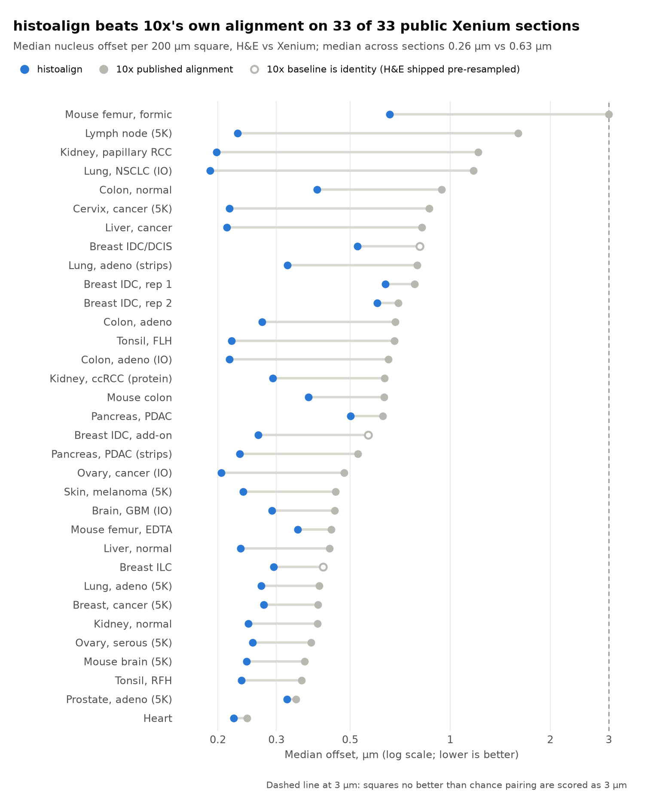

# Public-data benchmark: histoalign vs 10x's own H&E alignment

histoalign's alignment is closer to the H&E than 10x's on all 33 public Xenium sections tested (15 tissues,
human and mouse, Xenium Onboard Analysis 1.0 to 4.0). The median nucleus offset per section is 0.26 µm for
histoalign and 0.63 µm for 10x. Run on 2026-11-05 with histoalign 0.1.0.dev0 (nucleus QC v2).



## How it is measured

Both alignments are scored with the same check, `histoalign qc`. Xenium nucleus centroids (from
`nucleus_boundaries.parquet`) are matched to hematoxylin nuclei detected in the H&E (mutual nearest neighbours
within 3 µm). The offset of each pair is pooled into 200 µm squares; a square's error is the length of its median
offset vector, and a section's score is the median over its squares. The check does not use the
mutual-information objective that registration optimises, and both methods are scored on the same nuclei
(matched-pair counts within 1%).

Chance control (QC v2): in dense tissue, nuclei within 3 µm pair up even when an alignment is far off, and random
offsets have a median near zero. Each square is also matched against the H&E nuclei shifted by 12 µm (four
diagonals); a square whose real pair count is below 1.33x that chance count is scored as 3 µm.

## Headline numbers

| | histoalign | 10x |
| --- | --- | --- |
| Median of section medians (µm) | 0.26 | 0.63 |
| Median of section p90s (µm) | 0.49 | 1.10 |
| Median systematic offset (µm) | 0.15 | 0.34 |
| Sections with the lower median | 33 / 33 | 0 / 33 |

- 10x's median is a median 1.85x histoalign's (range 1.07-6.97x). Closest: heart (0.22 vs 0.25 µm) and
  prostate 5K (0.32 vs 0.34 µm).
- Pixel convention: reading 10x's matrix on pixel centres instead of corners, histoalign is still lower on 32 of
  33; heart becomes a tie (0.224 vs 0.220 µm). Column `tenx_median_centre_um`.
- Registration time on 2 CPUs: median 3.3 min, max 41 min (cervix 5K).

## Notes on individual sections

- **Identity baselines.** Breast IDC/DCIS, ILC (Xenium 1.0.2) and IDC with add-on (1.3.0) ship an H&E already
  resampled into the Xenium frame, so 10x's alignment there is the identity matrix. For the add-on section, the
  alignment CSV 10x publishes belongs to a different H&E scan (it sits about 6 mm from the image served); it is
  kept as `results/breast_idc_addon/10x_published_csv_mismatched.csv`.
- **Formic-acid femur.** The bone is deformed non-rigidly, so no single affine fits it. 10x is at chance in 341 of
  353 squares; histoalign in 75 of 447 (it follows the marrow, where most nuclei are).
- **Lymph node 5K.** Dense lymphoid tissue: 10x is at chance in 168 of 916 squares, histoalign in 36 of 935.

## Files

- `benchmark_summary.csv`: one row per section, every metric (from `compile.py`).
- `benchmark_dumbbell.png`, `.svg`: the figure (from `plot.py`).
- `datasets.csv`: the 33 sections (10x dataset name, Xenium version, H&E and alignment-CSV release).
- `results/<section>/`: `REPORT.md`, `metrics.json`, QC summaries for both alignments (`qc_final.json`,
  `qc_ext_10x.json`), per-square QC tables (`*_tiles.csv.gz`), histoalign's exported affine and per-region QC,
  and the 10x matrix scored. Overlay images are not kept here (about 5 MB each); rerun to regenerate them.

## Rerun

```bash
pip install -e ..  remotezip      # histoalign + range downloads from 10x
python bench.py --max-minutes 110 # resumable; finished sections are skipped
python compile.py                 # rebuilds benchmark_summary.csv and prints the headline numbers
python plot.py                    # redraws the figure
```

`bench.py` downloads only what is needed from each 10x dataset (the H&E, 10x's alignment CSV, and four members of
`outs.zip` by HTTP range), runs `histoalign register`, scores 10x's matrix with `histoalign qc`, and deletes the
raw data afterwards. Downloads go to `data/`, run outputs to `runs/`, logs to `logs/` (all git-ignored).
